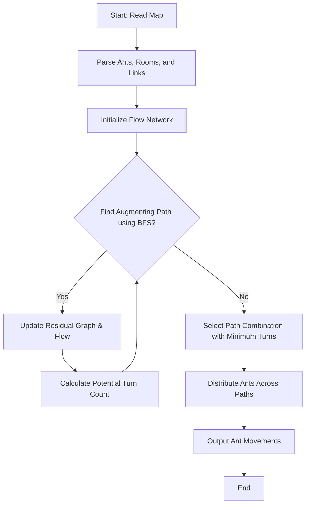

# Lem-in: Ant Farm Pathfinding Optimizer

[]()
[]()
[]()

A high-performance pathfinding and flow optimization engine designed to move hundreds of ants through a complex network of rooms with maximum efficiency.

## 🐜 The Problem

The goal is to find the quickest way to get $N$ ants across an "ant farm" composed of rooms and links. 

### Constraints:
- **Starting & Ending Rooms:** All ants begin at `##start` and must reach `##end`.
- **Room Capacity:** Each room (except start/end) can hold at most **one ant** at a time.
- **Turn-based Movement:** Each ant can move to an adjacent room exactly once per turn.
- **Path Collisions:** Paths must be **vertex-disjoint** to prevent collisions in rooms.

The challenge isn't just finding the shortest path, but finding the **optimal set of paths** that minimizes the total number of turns, considering the congestion caused by multiple ants.

## 🚀 Key Features

- **Max-Flow Algorithm:** Implementation of the Edmonds-Karp algorithm to find the maximum number of vertex-disjoint paths.
- **Ant Distribution Logic:** A greedy distribution strategy that balances path length against the number of ants to achieve the theoretical minimum turn count.
- **High-Performance Parsing:** Robust input handling for large maps (10,000+ rooms).
- **Custom Libft:** Built upon a custom-made C library providing optimized data structures (linked lists, queues, hash tables).

## 🧠 Algorithmic Deep Dive

### Pathfinding Strategy

The core of the engine uses a modified Edmonds-Karp algorithm to find the optimal set of vertex-disjoint paths.



### 1. Finding Paths (Edmonds-Karp)
We treat the ant farm as a flow network. Since rooms have a capacity of 1, we use **vertex splitting** (implicitly or explicitly) to transform the room capacity into an edge capacity. 
The algorithm iteratively finds the shortest augmenting path using **Breadth-First Search (BFS)** in the residual graph, allowing us to "undo" previous paths if a better global combination is found.

### 2. Optimizing Throughput
Once multiple paths are found, we don't necessarily use all of them. Using a very long path might be slower than waiting for a shorter one to clear.
Our engine calculates the "turn cost" for each additional path:
$$\text{Turns} = \lceil \frac{\text{Ants} + \sum (\text{PathLengths} - \text{MinPathLength})}{\text{Number of Paths}} \rceil + \text{MinPathLength} - 1$$

## 🛠 Installation & Usage

### Prerequisites
- GCC or Clang
- Make

### Building
```bash
make
```

### Running
```bash
./lem-in < maps/subject_1.map
```

Example Map Format:
```text
3
##start
start 1 2
##end
end 5 2
room1 3 4
start-room1
room1-end
```

## 📊 Performance

| Map Type | Rooms | Links | Ants | Time |
| :--- | :--- | :--- | :--- | :--- |
| Simple | 10 | 20 | 100 | < 0.01s |
| Complex | 1,000 | 5,000 | 5,000 | < 0.1s |
| Huge | 10,000 | 50,000 | 20,000 | < 0.5s |

## 🧪 Testing

The project includes a comprehensive test suite in `eval_tests/`. To run the automated tests:
```bash
python3 eval_tests/scripts/run_maps.py
```

## 📜 License
The lem-in project is licensed under the MIT License. See the [LICENSE](LICENSE) file for details.

---

*This project was developed as part of the Hive Helsinki (42 Network) curriculum, focusing on algorithm optimization and low-level systems programming in C.*
